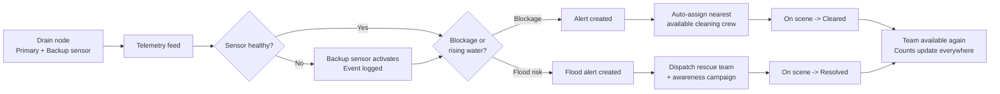

<div align="center">

# 🌊 SensaFlow

### Sense Early. Alert Instantly. Rescue Faster.

**A distributed flood warning and drainage blockage detection platform with dual-sensor failover, automatic crew assignment and coordinated rescue response.**

[](https://chakri9989040149-ai.github.io/resqtech/)
[](https://react.dev/)
[](https://vite.dev/)
[](https://pages.github.com/)
[](#-important-note-about-demo-data)

[**🔗 Live Demo**](https://chakri9989040149-ai.github.io/resqtech/) · [**📂 Repository**](https://github.com/chakri9989040149-ai/resqtech) · [**🐞 Report a Bug**](https://github.com/chakri9989040149-ai/resqtech/issues)

</div>

---

## 📑 Table of Contents

1. [Overview](#-overview)
2. [Extended Description](#-extended-description)
3. [Problem Statement](#-problem-statement)
4. [Our Solution](#-our-solution)
5. [How It Works](#-how-it-works)
6. [Key Features](#-key-features)
7. [Dashboard Modules](#-dashboard-modules)
8. [Technology Stack](#-technology-stack)
9. [System Architecture](#-system-architecture)
10. [Project Structure](#-project-structure)
11. [Getting Started](#-getting-started)
12. [Deployment](#-deployment)
13. [Important Note About Demo Data](#-important-note-about-demo-data)
14. [Roadmap](#-roadmap)
15. [Impact and Benefits](#-impact-and-benefits)
16. [Contributing](#-contributing)
17. [License](#-license)
18. [Author](#-author)

---

## 🌟 Overview

**SensaFlow** is a command-and-control web portal for disaster response teams. It watches city drains with paired IoT sensors, detects blockages and rising water before streets flood, and then **automatically alerts and assigns** the nearest available cleaning crew or rescue team.

It brings flood alerts, drain monitoring, rescue teams, relief shelters, offline communication and maintenance into one clean dashboard that is simple to understand, even under pressure.

> **In one line:** SensaFlow turns drain sensor data into fast, coordinated action, before the flood arrives.

---

## 📖 Extended Description

Urban flooding rarely starts with a river. It usually starts with a **small, unnoticed failure**: a drain choked with silt and plastic, a sensor that stopped reporting, or an alert that reached the wrong person too late. By the time authorities hear about it, water is already on the road.

SensaFlow is built around a simple idea: **detect early, never lose visibility, and remove delay between "alert" and "action".**

- **Early detection:** Every drain node carries sensors that report water level and a blockage index continuously. The system flags suspected blockages while there is still time to clear them.
- **Never go blind:** Each node uses a **primary and a backup sensor**. If the primary fails, the backup activates automatically, much like the second engine of an aircraft, so monitoring continues without interruption.
- **No delay in response:** When a blockage or flood alert is raised, SensaFlow selects the best available crew by team type, nearest zone and current availability, dispatches them, and tracks the job until it is resolved. A freed team becomes available again automatically.
- **Prevent, not just react:** Flood alerts trigger rescue deployment and **preventive awareness campaigns in the affected area before flooding spreads**.
- **Works when networks don't:** If mobile or internet coverage drops during a storm, nodes fall back to **LoRa** low-power radio, and queued alerts are delivered as soon as a link is available.
- **Everything in one place:** Six focused tabs cover the full cycle, from sensing to rescue to maintenance, with a shared activity log so every action is traceable.

The interface is designed for stressful situations: clear status colours, large readable numbers, step-by-step flows, light and dark themes, and no clutter.

---

## ❗ Problem Statement

| Challenge | Impact |
|---|---|
| Drains clog silently with silt, plastic and debris | Water backs up onto streets within minutes of heavy rain |
| A single sensor failure creates a monitoring blind spot | Blockages go unreported exactly when risk is highest |
| Alerts are manual and phone-based | Slow, inconsistent and easy to miss |
| Teams are assigned by guesswork | Wrong team, wrong place, or two teams on one job |
| Communication networks fail during storms | Field data and alerts stop flowing |
| Prevention is rare | Communities are warned only after flooding begins |

---

## ✅ Our Solution

| Problem | SensaFlow answer |
|---|---|
| Silent blockages | Continuous water-level and blockage-index monitoring on every drain node |
| Sensor failure | **Dual-sensor failover**: the backup activates automatically |
| Slow, manual alerts | Instant alerts raised and routed by the system |
| Guesswork assignment | **Automatic assignment** by team type, nearest zone and availability, with manual override |
| Network failure | **LoRa fallback** and queued alerts |
| No prevention | Preventive **awareness campaigns** scheduled before the flood |
| Scattered information | One **command dashboard** with a live activity log |

---

## 🔄 How It Works



**Step by step**

1. **Sense:** Each drain node reports water depth and a blockage index.
2. **Protect:** If the primary sensor fails, the backup takes over automatically.
3. **Detect:** Thresholds raise a blockage or flood alert.
4. **Assign:** The best available team or worker is chosen by type, zone and availability.
5. **Respond:** Status moves from *Assigned* to *On Scene* to *Resolved*.
6. **Recover:** The team is freed, counts refresh across all tabs, and the log records every step.

---

## ✨ Key Features

### 🛰️ Monitoring and detection
- Live summary cards for active flood alerts, suspected blockages, drain nodes online, rescue teams active and relief camps operating
- GIS-style **risk map** and IoT sensing grid with clickable nodes showing water depth and blockage index
- **Catchment weather panel** with rainfall intensity, temperature, humidity, wind and 24-hour cumulative rain, powered by the Open-Meteo API
- **Dual-sensor failover** with *Active / Failed / Standby* status badges

### 🚨 Alerting and response
- Central **Flood Alert Center** with severity, location, time and status
- **Automatic team assignment** with a manual dropdown override
- Busy teams cannot be double-booked, and a clear message appears if nobody is free
- Reassign, mark on scene and mark resolved actions
- **Public Alerts Feed** for citizen-facing notices

### 🧰 Operations
- Rescue team and relief shelter management with live occupancy
- Preventive **awareness campaigns** scheduled before flooding
- Maintenance task board with auto-created tasks and worker assignment
- **Offline and LoRa** communication health with outage simulation and alert queueing
- Timestamped **Activity Log** for full traceability

### 🎨 Experience
- Clean, professional, government-grade interface
- Light and **dark mode**
- Responsive layout, keyboard-friendly controls and clear status colours
- Demo login with a role-based officer profile and a one-click **Reset Demo Data**

---

## 🧩 Dashboard Modules

| Tab | Purpose | Highlights |
|---|---|---|
| **1. Overview** | Summary and map | Five live cards, weather conditions, risk map, node inspection |
| **2. Drain Monitoring** | Sensor readings | Water level, blockage index, primary and backup sensor state, failover |
| **3. Alerts** | Flood Alert Center | Assign, reassign, acknowledge, resolve, public notices |
| **4. Rescue and Relief** | Teams and shelters | Team status, shelter occupancy, awareness campaigns |
| **5. Offline and LoRa** | Communication health | Link state, signal strength, outage simulation, queued alerts |
| **6. Maintenance** | Flood and drain upkeep | Task list, auto-created jobs, worker assignment, clearing blockages |

---

## 🛠️ Technology Stack

### Frontend (implemented)

| Technology | Role |
|---|---|
| **React** and **React DOM** | Component-based user interface |
| **Vite** | Fast dev server and optimized production build |
| **JavaScript (ES6+) and JSX** | Application logic and components |
| **React Context API** | Shared state through `AuthContext`, `FloodGuardStore` and `ThemeContext` |
| **Lucide React** | Consistent, lightweight icon set |
| **CSS3** | Custom styling, theming with light and dark modes, responsive layout |
| **Open-Meteo API** | Real-time rainfall, temperature, humidity and wind data |
| **SVG** | Favicon, icons and map graphics |

### Backend and data (architecture prepared)

| Technology | Role |
|---|---|
| **Prisma ORM** | Type-safe database modelling and migrations (`prisma/`) |
| **libSQL / SQLite-compatible database** | Lightweight, edge-friendly data storage |
| **Node.js** | Runtime for tooling, scripts and the backend service |
| **Environment variables (`.env`)** | Secure configuration, with `.env.example` provided |
| **`smart-drain-monitor/`** | Service module for sensor ingestion and monitoring logic |
| **`scripts/`** | Utility and seed scripts |

### IoT and communication (system design)

| Technology | Role |
|---|---|
| **Paired ultrasonic / water-level sensors** | Primary and backup depth measurement per drain node |
| **ESP32 / microcontroller nodes** | Reading sensors and transmitting telemetry |
| **LoRa / LoRaWAN** | Long-range, low-power fallback when mobile networks fail |
| **MQTT / WebSockets** | Real-time telemetry streaming to the dashboard |
| **SMS and public alert gateway** | Citizen notification channel |

### Developer tooling and DevOps

| Technology | Role |
|---|---|
| **Git and GitHub** | Version control and collaboration |
| **GitHub Actions** | Automated build and deployment (`.github/workflows/deploy.yml`) |
| **GitHub Pages** | Free static hosting for the live demo |
| **npm** | Dependency management |
| **Oxlint** | Fast linting (`.oxlintrc.json`) |
| **Prettier** | Consistent code formatting (`.prettierrc`) |
| **EditorConfig** | Consistent editor settings across machines |
| **Vitest** | Unit testing support |

### Advanced technologies planned

| Technology | Purpose |
|---|---|
| **Machine learning** | Predict blockages and flood risk from rainfall and sensor history |
| **Progressive Web App (PWA)** | Installable, offline-capable field app |
| **Real map engine** (Leaflet or MapLibre) | Real GIS layers and geofenced alerts |
| **Role-based access control and JWT** | Secure officer, crew and admin roles |
| **Push notifications** | Instant alerts to field teams |
| **Time-series database** | Long-term sensor analytics |

> **Note:** The deployed demo is a front-end application running on simulated data. Items under *Backend*, *IoT* and *Advanced technologies planned* describe the target system design and roadmap.

---

## 🏗️ System Architecture

```
┌──────────────────────────────────────────────────────────────┐
│                       FIELD LAYER (IoT)                      │
│   Drain nodes: Primary sensor + Backup sensor + Controller   │
└───────────────┬──────────────────────────────┬───────────────┘
                │ Mobile / Wi-Fi               │ LoRa fallback
┌───────────────▼──────────────────────────────▼───────────────┐
│                 INGESTION AND LOGIC LAYER                    │
│   Telemetry intake -> Failover check -> Threshold rules      │
│   Alert creation -> Auto-assignment engine -> Queueing       │
└───────────────────────────────┬──────────────────────────────┘
                                │
┌───────────────────────────────▼──────────────────────────────┐
│                         DATA LAYER                           │
│            Prisma ORM  ->  libSQL / SQL database             │
└───────────────────────────────┬──────────────────────────────┘
                                │
┌───────────────────────────────▼──────────────────────────────┐
│                  PRESENTATION LAYER (React)                  │
│  Command Dashboard · Public Alerts Feed · Activity Log       │
│  Shared store: Auth · FloodGuardStore · Theme                │
└──────────────────────────────────────────────────────────────┘
```

---

## 📁 Project Structure

```
resqtech/
├── .github/
│   └── workflows/
│       └── deploy.yml          # Build and deploy to GitHub Pages
├── prisma/                     # Database schema and migrations
├── public/                     # Static assets (favicon.svg, icons.svg)
├── scripts/                    # Utility and seed scripts
├── smart-drain-monitor/        # Sensor monitoring service module
├── src/
│   ├── assets/                 # Images and static resources
│   ├── components/             # Reusable UI components (cards, drawers, map)
│   ├── context/
│   │   ├── AuthContext.jsx     # Demo login and role handling
│   │   ├── FloodGuardStore.jsx # Shared alerts, teams, nodes and log state
│   │   └── ThemeContext.jsx    # Light and dark mode
│   ├── pages/                  # Dashboard tabs and public alerts feed
│   ├── services/               # API and weather data services
│   ├── App.jsx
│   ├── App.css
│   ├── index.css
│   └── main.jsx
├── .editorconfig
├── .env.example                # Environment variable template
├── .gitignore
├── .oxlintrc.json
├── .prettierrc
├── index.html
├── package.json
├── vite.config.js
└── README.md
```

---

## 🚀 Getting Started

### Prerequisites
- **Node.js** 20 or later
- **npm** (comes with Node.js)
- **Git**

### Installation

```bash
# 1. Clone the repository
git clone https://github.com/chakri9989040149-ai/resqtech.git

# 2. Move into the project
cd resqtech

# 3. Install dependencies
npm install

# 4. Create your environment file
cp .env.example .env
# On Windows PowerShell: copy .env.example .env

# 5. Start the development server
npm run dev
```

Open **http://127.0.0.1:5173/resqtech/** in your browser.

### Available scripts

| Command | Description |
|---|---|
| `npm run dev` | Start the development server |
| `npm run build` | Create an optimized production build in `dist/` |
| `npm run preview` | Preview the production build locally |

### Demo login
The demo signs you in as **Demo Officer, Disaster Response Coordinator**. Use **Reset Demo Data** in the dashboard header to restore the starting scenario at any time.

---

## 🌐 Deployment

The project deploys automatically to **GitHub Pages** through GitHub Actions on every push to `main`.

1. In the repository, go to **Settings → Pages** and set **Source** to **GitHub Actions**.
2. In **Settings → Environments → github-pages**, allow deployments from the `main` branch.
3. Make sure `vite.config.js` contains `base: '/resqtech/'`.
4. Push to `main`, then watch progress under the **Actions** tab.

**Live site:** https://chakri9989040149-ai.github.io/resqtech/

---

## ⚠️ Important Note About Demo Data

SensaFlow is currently a **demonstration prototype**. All alerts, teams, workers, shelters, sensor readings and names shown in the dashboard are **fictional and simulated**, and are marked with **[SIMULATED]** and **DEMO DATA** labels. Weather conditions are fetched from the public Open-Meteo API. Do not use this build as a real emergency system without connecting verified sensors, secure authentication and official data sources.

---

## 🗺️ Roadmap

- [x] Command dashboard with six operational tabs
- [x] Dual-sensor failover logic and status badges
- [x] Automatic team and worker assignment with manual override
- [x] Offline and LoRa communication simulation
- [x] Light and dark themes
- [x] Automated deployment with GitHub Actions
- [ ] Connect real IoT hardware (ESP32 + paired sensors)
- [ ] Live database through Prisma for persistent records
- [ ] Real GIS map layers and geofenced zone alerts
- [ ] Authentication with role-based access control
- [ ] SMS and push notifications for field teams and citizens
- [ ] Predictive blockage and flood-risk models
- [ ] Installable PWA with offline field mode
- [ ] Multilingual interface (English, Telugu, Hindi)
- [ ] Analytics and monthly reports for authorities

---

## 💡 Impact and Benefits

- **Faster response:** automatic assignment removes the delay between alert and action
- **Fewer floods:** blockages are cleared before water rises
- **Higher reliability:** the backup sensor keeps every node visible
- **Better coordination:** one shared view prevents duplicated or missed jobs
- **Community safety:** early awareness campaigns reach people before the water does
- **Lower cost:** preventive maintenance is cheaper than disaster recovery
- **Accountability:** a timestamped log records who did what and when

---

## 🤝 Contributing

Contributions are welcome.

1. Fork the repository
2. Create a feature branch: `git checkout -b feature/your-feature`
3. Commit your changes: `git commit -m "Add your feature"`
4. Push the branch: `git push origin feature/your-feature`
5. Open a Pull Request

Please keep the interface clean, run `npm run build` before submitting, and never commit `.env` files or secrets.

---

## 📄 License

This project is released under the **MIT License**. See the `LICENSE` file for details.

---

## 👤 Author

**chakri9989040149-ai**
GitHub: [@chakri9989040149-ai](https://github.com/chakri9989040149-ai)

---

<div align="center">

**SensaFlow: Sense Early. Alert Instantly. Rescue Faster.** 🌊

⭐ If you like this project, please give it a star.

</div>
